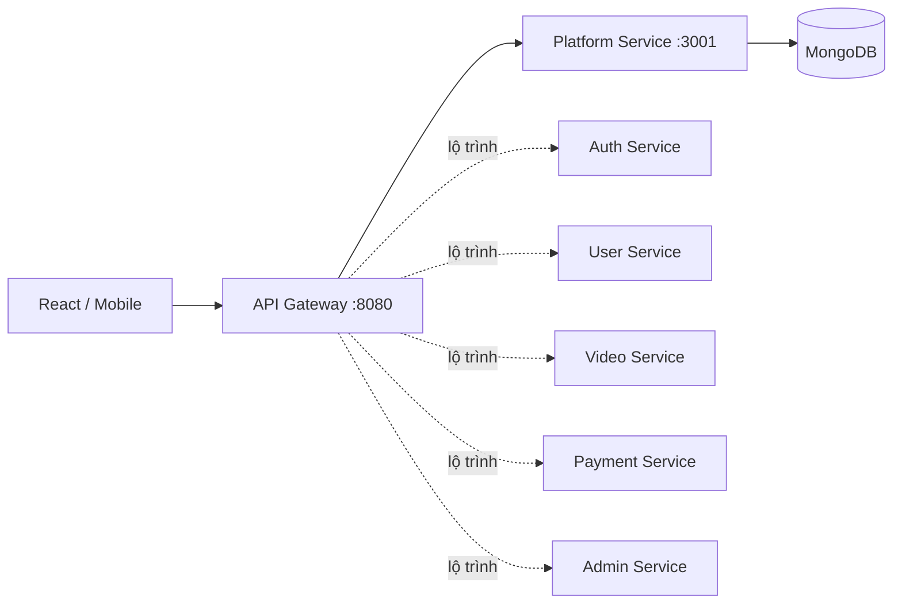

# Kiến trúc mục tiêu

## Nguyên tắc chuyển đổi

- Strangler pattern: giữ platform-service hoạt động đồng thời với các service mới.
- API Gateway là điểm vào duy nhất ở môi trường v2.
- Không sao chép trực tiếp database; mỗi bounded context sở hữu schema collection riêng.
- Giai đoạn đầu dùng REST đồng bộ; sau đó chuyển event bất đồng bộ cho notification và realtime.
- JWT phải được xác thực hoặc hợp lệ qua gateway; nội bộ service truyền identity qua header đã tin cậy.
